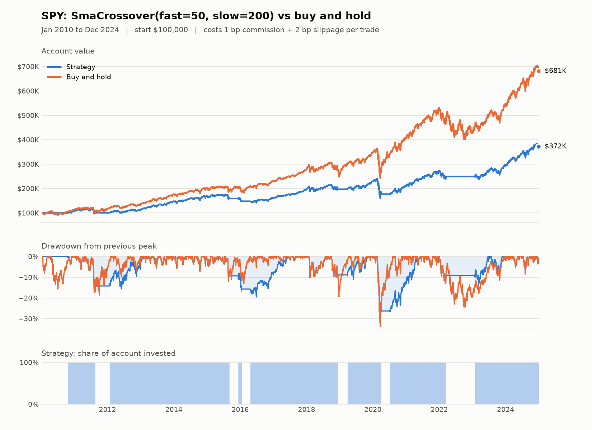

# Algorithmic Trading Strategy Backtester

[](https://github.com/yeshigurmey/algo-trading-backtester/actions/workflows/ci.yml)

A backtesting engine in Python. It pulls historical daily prices from Yahoo
Finance, simulates rule-based trading strategies one day at a time, and
compares each strategy with simply buying and holding the asset, using total
return, Sharpe ratio and maximum drawdown.

Most of the work went into avoiding the three ways a backtest usually flatters
a strategy:

| Common flaw | What this project does about it |
|---|---|
| **Look-ahead bias**: trading on a price that was not known yet | A decision made at one day's close is filled at the *next* day's open. A replay test checks that each strategy's past decisions do not change when later data is added. |
| **Free trading**: ignoring costs | Every fill pays slippage and commission, shares are whole numbers, and the account can never spend cash it does not have. |
| **Overfitting**: reporting the best of many parameter sets | Walk-forward analysis picks parameters on one window and scores them on the next, unseen one. |

## Quick start

```bash
git clone https://github.com/yeshigurmey/algo-trading-backtester.git
cd algo-trading-backtester
python -m venv .venv && source .venv/bin/activate
pip install -e ".[dev]"

# Backtest a 50/200-day moving-average crossover on SPY against buy-and-hold
backtester run --ticker SPY --start 2010-01-01 --end 2025-01-01 \
    --strategy sma -p fast=50 -p slow=200 --plot results/spy_sma.png

# Try a grid of parameters (in-sample), then test them honestly (out-of-sample)
backtester sweep       --ticker SPY --strategy sma -g fast=10,20,50 -g slow=100,150,200
backtester walkforward --ticker SPY --strategy sma -g fast=10,20,50 -g slow=100,150,200

# No internet? Every command also runs on a seeded random walk
backtester run --synthetic 3 --strategy sma -p fast=20 -p slow=100

pytest   # run the test suite
```

Strategies: `sma` (moving-average crossover), `momentum` (trailing return),
`meanrev` (Bollinger bands), `buyhold`. Run `backtester run --help` for the
account and cost options.

## Results: SPY, 2010 to 2024

A 50/200-day moving-average crossover on SPY (S&P 500 ETF) against buy-and-hold,
starting with $100,000 and paying 1 bp commission plus 2 bp slippage per trade:

```bash
backtester run --ticker SPY --start 2010-01-01 --end 2025-01-01 \
    --strategy sma -p fast=50 -p slow=200 --plot results/spy_sma.png
```

```
SPY: 3,774 trading days, 2010-01-04 to 2024-12-31
                  SmaCrossover(fast=50, slow=200) Buy and hold
final_equity                          $371,520.81  $681,178.28
total_return                              271.52%      581.18%
cagr                                        9.15%       13.66%
volatility                                 13.72%       17.05%
sharpe                                       0.71         0.84
sortino                                      0.97         1.17
max_drawdown                              -33.71%      -33.71%
max_drawdown_days                             478          488
calmar                                       0.27         0.41
exposure                                   78.99%       99.97%
round_trips                                     7            1
win_rate                                   71.43%      100.00%
costs_paid                                $648.89       $29.98
```



**The crossover lost to buy-and-hold on every measure that matters here.** Three
things explain it:

- **It was out of the market 21% of the time during a long bull run.** Sitting
  in cash while the index rose 581% meant missing part of that rise. Volatility
  was lower (13.7% vs 17.1%), but return fell by more, so the Sharpe ratio
  dropped from 0.84 to 0.71.
- **It gave no protection in the worst fall.** Both columns show the same 33.71%
  maximum drawdown. A 200-day average needs months to turn, and the 2020 crash
  took weeks, so the strategy was still fully invested all the way down.
- **Costs were not the reason.** Seven round trips cost $649 in total, a small
  fraction of the $310,000 gap.

Figures come from Yahoo Finance data as downloaded in November 2026; Yahoo
revises adjusted prices over time, so a fresh download may differ slightly.

## How one simulated day works

```
        close of day t                 open of day t+1            close of day t+1
              |                              |                          |
  strategy sees prices up to t     order is filled here:        account is valued:
  and sets a target weight         buy at  open x (1 + slippage)  equity = cash + shares x close
  (0 = all cash, 1 = invested)     sell at open x (1 - slippage)
                                   commission on traded value
```

The buy-and-hold benchmark runs through the same engine with the same costs,
so the comparison is like for like.

## Project layout

```
src/backtester/
  data.py        download (yfinance), validate, cache to CSV; seeded random-walk generator
  strategies.py  Strategy interface, the four strategies, look-ahead detector
  engine.py      event-driven simulator: fills, costs, cash and share accounting
  metrics.py     return, CAGR, volatility, Sharpe, Sortino, drawdown, trade statistics
  vectorized.py  the same rules as array arithmetic, for fast parameter sweeps
  optimize.py    grid search and walk-forward analysis
  report.py      metrics table and three-panel chart
  cli.py         the `backtester` command
tests/           ~90 tests
benchmarks/      engine timings
docs/DESIGN.md   the reasoning behind each design decision
```

## Writing your own strategy

A strategy is a small class that returns a target weight between 0 and 1 for
each day, using only data up to that day:

```python
from dataclasses import dataclass
import pandas as pd
from backtester.data import load_prices
from backtester.engine import run_backtest
from backtester.metrics import summarize
from backtester.strategies import Strategy, find_lookahead


@dataclass(frozen=True)
class AboveAverage(Strategy):
    """Invested while the close is above its `window`-day average."""

    window: int = 100

    def target_weights(self, prices: pd.DataFrame) -> pd.Series:
        close = prices["close"]
        return (close > close.rolling(self.window).mean()).astype("float64")


prices = load_prices("SPY", "2010-01-01", "2025-01-01")
assert find_lookahead(AboveAverage(), prices) is None  # past decisions never change
print(summarize(run_backtest(prices, AboveAverage())))
```

## How it is tested

- **By-hand cases.** Trades and every metric are checked against values worked
  out on paper for tiny price series.
- **Accounting invariants.** For every strategy: cash never goes negative,
  shares are whole, equity equals cash plus holdings, and final cash reconciles
  exactly with the trade log.
- **Two engines, one answer.** The event-driven and vectorised engines are
  independent implementations of the same rules. They must agree to 1e-9
  without costs and 1e-4 with costs.
- **No free lunch.** On a random walk with no drift, the mean return of each
  strategy over 200 simulated paths must be statistically zero, while a
  deliberately cheating strategy that reads tomorrow's close must profit. This
  catches look-ahead bias anywhere in the pipeline.
- **Walk-forward is blind to the future.** Appending later data must not change
  any earlier window's chosen parameters or results.

CI runs linting (ruff) and the tests on Python 3.10 and 3.13.

## Performance

Measured with `python benchmarks/bench.py` on 20 years of daily bars (5,040
rows); figures vary by machine:

| | Time |
|---|---|
| Event-driven backtest | about 2.5 ms (roughly 500 ns per bar) |
| Vectorised backtest | about 0.4 ms |
| 400-combination parameter sweep | about 0.25 s |

Indicators are computed once in a single pandas pass, and the simulation loop
runs on NumPy arrays and plain floats rather than indexing a DataFrame per row.

## Limitations

This is a research tool for daily-bar strategies on a single asset, and it
makes simplifying assumptions that matter:

- **Long-only, no leverage, one asset at a time.** No short selling, margin or
  multi-asset portfolios.
- **Fills are assumed at the opening price** plus a fixed slippage. Orders are
  assumed small enough not to move the market.
- **Costs are a flat percentage** of traded value. Real costs depend on the
  broker, the spread and the order size.
- **Idle cash earns nothing**, and taxes are ignored.
- **Yahoo data is adjusted after the fact** for splits and dividends and is not
  point-in-time. Testing only tickers that exist today also ignores companies
  that were delisted (survivorship bias).
- A good backtest is evidence that a rule *would have* worked, not that it will.

## Tech stack

Python 3.10+, pandas, NumPy, yfinance, Matplotlib, pytest, ruff, GitHub Actions.

## Licence

MIT
